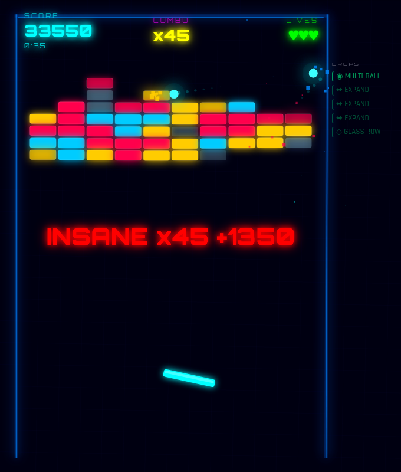
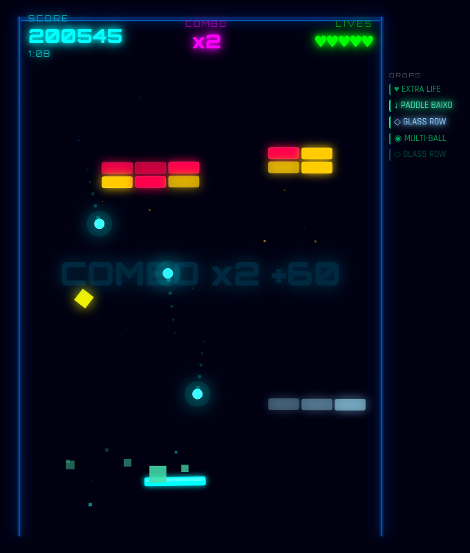

# SHATTER GRID // TURBO 2D

> A neon brick breaker for the browser, with combos, 16 random drops, bombs and chiptune music, all in one HTML file.



**[Play the game in your browser](https://salvimateus.github.io/shattergrid-turbo-2d/shattergrid_turbo_2d.html)**

## What it is

Shatter Grid Turbo 2D is a single-player brick breaker game. You move a paddle at the bottom of a neon field. You keep a glowing ball in play and break a wall of bricks.

- Each broken brick can release a drop. A drop can help you or make the game harder.
- Consecutive brick hits build a combo that multiplies your points.
- The game draws everything on an HTML canvas. It does not use images or audio files.
- The interface text is in Brazilian Portuguese.

## How to play

### Goal

Destroy all the normal bricks before you lose all your lives.

### Rules

- The field has 7 rows of 10 bricks.
- A normal brick takes 1, 2 or 3 hits. Its color shows its strength: cyan is 1 hit, yellow is 2 hits, red is 3 hits.
- Some bricks are glass. The ball goes through glass and breaks it. Glass bricks do not count for the win.
- You start with 3 lives. Extra lives can raise this to 5.
- At the start, and after each lost life, the ball charges on the paddle for about 1.5 seconds. Then it launches automatically.
- The angle of the bounce depends on where the ball hits the paddle.
- The ball gets a little faster each time it hits the paddle or breaks a brick, up to a maximum speed.
- When the last ball falls below the paddle, you lose a life.
- You win when no normal brick remains. You lose when no life remains.

### Scoring

- A hit on a normal brick gives 15 points for each hit point of the brick, multiplied by the current combo.
- A hit on a glass brick gives 5 points, multiplied by the current combo.
- Each brick hit adds 1 to the combo. A paddle hit or a lost life sets the combo back to 0.
- From a combo of 2, a label shows on the screen: COMBO, NICE, AMAZING, GODLIKE, UNSTOPPABLE and INSANE (15 or more).
- A bomb explosion gives double points for each brick that it destroys.

### Controls

| Action | Desktop | Touch screen |
| --- | --- | --- |
| Start or restart a game | Click | Tap |
| Move the paddle | Move the mouse left or right | Drag a finger |
| Pause or continue | `Esc` or `Space` | Tap with two fingers |

- On desktop, the paddle follows the relative movement of the mouse, not the cursor position. The game hides the cursor.
- Push the paddle against a side wall to tilt that wall. A tilted wall changes the bounce angle of the ball.
- The game has no keyboard movement and no gamepad support.

### Drops

A destroyed brick releases a drop with a chance of 65%. A maximum of 3 drops can fall at the same time. Catch a drop with the paddle to use it.

| Drop | Effect | Duration |
| --- | --- | --- |
| ⬌ EXPAND | Makes the paddle wider | 8 s |
| ◉ MULTI-BALL | Adds one more ball | Until the ball falls |
| ♥ EXTRA LIFE | Adds one life, to a maximum of 5 | Permanent |
| ◇ GLASS ROW | Puts a row of glass bricks above the paddle | 16 s |
| 💣 BOMB | Launches a bomb that bounces on the walls and the paddle, then explodes on a brick and destroys up to 3 bricks near it | Until it explodes or falls |
| 🐢 CÂMERA LENTA | Slows the game to 80% speed | 3 s |
| ↓ PADDLE BAIXO | Moves the paddle lower | 8 s |
| 🎯 MIRA LASER | Shows the path of the ball and its next bounce | 16 s |
| ⬌ SHRINK | Makes the paddle narrower | 4 s |
| ⚡ CÂMERA RÁPIDA | Speeds the game to 120% speed | 3 s |
| ↑ PADDLE ALTO | Moves the paddle higher | 8 s |
| ◐ PRETO & BRANCO | Shows the game in black and white | 8 s |
| 📺 TV CRT | Adds a CRT scanline filter | 10 s |
| 🎬 FILME ANTIGO | Adds an old film filter with sepia and noise | 12 s |
| 🌀 GIRO LOUCO | Makes the paddle spin | 5 s |
| 👻 FANTASMA | Makes the paddle almost invisible | 5 s |

- The first 8 drops in the table help you. The last 8 make the game harder.
- The drop on the screen has a random color, so you do not know its type before you catch it.
- A log at the side of the field shows the last 5 drops. Timed drops glow while they are active.
- On mobile devices, CÂMERA LENTA, CÂMERA RÁPIDA and FILME ANTIGO do not appear.



## Features

- Neon visuals with glow, particles, ball trails and screen shake.
- Side walls that shake on impact and tilt when you push the paddle against them.
- Sound effects made in real time with the Web Audio API.
- Chiptune background music with 3 levels of intensity. The music gets faster and stronger when 50% and then 10% of the bricks remain.
- Muffled music when the game is paused or over.
- A timer during the game and the final time on the win screen.
- A local scoreboard with your last 10 games and your top 10 scores.
- A list of the drops that you collected on the end screens.
- A responsive layout for desktop and mobile screens, with lighter effects on mobile devices.

## Run the game

Play online: [salvimateus.github.io/shattergrid-turbo-2d](https://salvimateus.github.io/shattergrid-turbo-2d/shattergrid_turbo_2d.html).

To run a local copy:

1. Download or clone the repository.
2. Open `shattergrid_turbo_2d.html` in a modern web browser.

- You do not need a server, a build step or an installation.
- All the game code is in that one file. You can share the file alone.
- The game loads the Orbitron and Rajdhani fonts from Google Fonts. This is its only network request.
- The scoreboard uses the `localStorage` of the browser. Scores stay in that browser only.
- On mobile devices, the background music is off. The sound effects stay on.

## Build from source

The source code is in `src/`. The build joins it into the playable HTML file.

Requirement: Node.js. The build uses only the built-in `fs` and `path` modules. There are no packages to install.

```bash
node build.js
```

The build does these steps:

1. It reads the 14 modules in `src/` in a fixed order. The order is important, because all modules share one scope.
2. It joins the modules into one block of code.
3. It puts that block into `template.html`, in place of the `/* __GAME_CODE__ */` placeholder.
4. It writes the result to `shattergrid_turbo_2d.html` and shows the size of the file.

- If a module is missing, the build stops with an error.
- Do not edit `shattergrid_turbo_2d.html` directly. The next build replaces it.

## Project structure

```text
.
├── build.js                  Joins the modules in src/ into the final HTML file
├── template.html             Page shell: HTML, CSS, HUD and the start, pause and end screens
├── shattergrid_turbo_2d.html Built game, ready to play (generated by build.js)
├── docs/screenshots/         Screenshots for this README
└── src/
    ├── config.js             Constants for the field, paddle, ball, bricks and mobile settings
    ├── state.js              Shared game state variables
    ├── audio.js              Sound effects made with the Web Audio API
    ├── music.js              Background music, intensity levels and the muffle effect
    ├── renderer.js           Canvas setup, coordinate helpers, background grid and walls
    ├── paddle.js             Paddle drawing, size and thruster particles
    ├── ball.js               Ball creation and drawing
    ├── bricks.js             Brick grid creation, brick drawing and music intensity
    ├── particles.js          Particles, ball trails and screen shake
    ├── drops.js              Drop types, falling drops, screen filters and the drop log
    ├── bombs.js              Bomb movement, bounces and explosions
    ├── scoreboard.js         Score storage and the scoreboard tables
    ├── ui.js                 HUD, combo and life popups, and HUD position
    └── game.js               Drop effects, physics, collisions, main loop and input
```

## Technical notes

- Rendering: the HTML Canvas 2D API, with `requestAnimationFrame`. The game does not use WebGL.
- Game world: the game uses a field of 14 by 20 units. It scales the field to the window size.
- Physics: the game runs one physics step for each frame. The slow and fast drops change the number of steps.
- Paddle collision: the game tests the ball against the rotated paddle, so a tilted or spinning paddle changes the bounce.
- Screen filters: the black and white, CRT and old film drops use CSS filters and overlays on the canvas.
- Audio: oscillators and noise buffers of the Web Audio API. There are no audio files.
- Storage: `localStorage`, key `shattergrid_scores_v1`, with a maximum of 100 saved games.
- Libraries: none. The game uses only browser APIs. The only external resource is the Google Fonts stylesheet.
- Build: a Node.js script with no dependencies. There is no `package.json`.

## Status

- The game is playable from the start screen to the win screen and the game over screen.
- It has one level. The brick layout is random for each game.
- The repository has no release and no version number.

## License

This project is under the MIT License. See [LICENSE](LICENSE).
